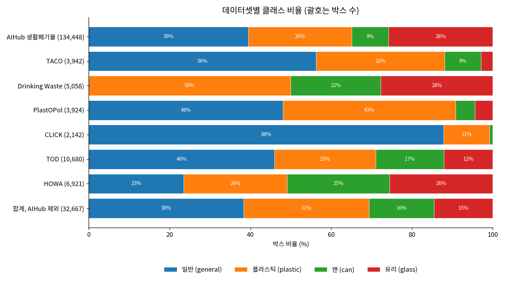

# 데이터셋

쓰레기 탐지 모델을 학습하는 데이터입니다. 로봇의 수거함 4칸에 맞춰 모든 데이터셋을 같은 4클래스로 바꿔 두었습니다.

| id | 클래스 | 들어가는 것 |
| ---: | --- | --- |
| 0 | general (일반) | 종이류, 비닐·과자 봉지, 그 밖의 일반 쓰레기 |
| 1 | plastic (플라스틱) | 페트병, 단단한 플라스틱 용기 |
| 2 | can (캔) | 음료 캔, 통조림 캔 |
| 3 | glass (유리) | 유리병, 유리 용기 |

기준은 **재질이 아니라 품목**입니다. 비닐봉지는 재질로는 플라스틱이지만 general입니다 (TACO 변경 이력 참고).

## 한눈에 보기

| 데이터셋 | 장면 | 학습 / 검증 / 시험 이미지 | 박스 | 라이선스 | git |
| --- | --- | ---: | ---: | --- | --- |
| [AIHub 생활폐기물](#aihub-생활폐기물) | 어두운 수거함 안, 위에서 촬영 | 102,271 / 12,784 / 없음 | 134,448 | AIHub 약관 | 라벨 |
| [TACO](#taco) | 야외 (숲, 길, 해변), 휴대폰 | 1,200 / 150 / 150 | 3,942 | MIT / CC BY 4.0 | 라벨 |
| [Drinking Waste](#drinking-waste) | 단순한 배경에 음료 용기 하나 | 3,848 / 482 / 481 | 5,058 | CC0 1.0 | 라벨 |
| [PlastOPol](#plastopol) | 야외, 시민 촬영 사진 | 988 / 399 / 500 | 3,924 | CC BY 4.0 | 라벨 |
| [CLICK](#click) | 야외 바닥 (흙, 낙엽, 풀), 휴대폰 | 875 / 109 / 110 | 2,142 | MIT | 라벨 |
| [TOD](#tod) | 실내 타일 바닥, 한국 쓰레기 | 2,180 / 208 / 335 | 10,680 | 자유 사용 | 라벨 |
| [HOWA](#howa) | 야외 바닥, 삼각대, 한 장에 하나 | 5,642 / 784 / 495 | 6,921 | 비영리 전용 | **제외** |

라이선스와 인용 정보는 [LICENSES.md](LICENSES.md)에 있습니다. 이미지는 용량 때문에 git에 올리지 않습니다 (`.gitignore`).



- AIHub를 빼면 박스 32,667개 중 일반 38%, 플라스틱 31%, 캔 16%, 유리 15%입니다.
- 야외 장면에서 유리와 캔이 충분한 것은 HOWA뿐입니다. CLICK은 거의 일반이고, TOD와 Drinking Waste는 야외가 아닙니다.
- 분할별 숫자는 [reports/figures/01_class_by_split.png](reports/figures/01_class_by_split.png), 모든 표는 [reports/tables.md](reports/tables.md)에 있습니다.

## 데이터셋별 설명

각 데이터셋마다 **원본**(누가 어떻게 모았는가), **가공**(우리가 무엇을 바꿨는가), **주의할 점**을 적었습니다. "확인 필요"는 이 문서를 쓸 때 근거를 찾지 못한 부분입니다.

### AIHub 생활폐기물

- **원본**: [AIHub 생활폐기물 데이터](https://aihub.or.kr/aihubdata/data/view.do?dataSetSn=71385). 어두운 수거함 안에 쓰레기를 넣고 위에서 찍은 사진입니다. 거의 모두 640×481입니다. AIHub가 학습(Training)과 검증(Validation)만 나눠서 제공해 시험 분할이 없습니다.
- **가공**: 원본 클래스를 4클래스로 매핑했습니다 (매핑표 확인 필요). 일부는 줍줍 라벨러로 검수했습니다 (`aihub_living_yolo/.bbox_labeler/state.json`).
- **주의할 점**
  - **박스가 없는 이미지가 8,966장(7.8%)** 있습니다. 미리보기를 보면 흰 스티로폼 트레이가 찍혀 있는데 박스가 없는 경우가 있습니다. 매핑에서 뺀 클래스의 박스만 지우고 이미지는 남긴 것으로 보입니다. 이러면 모델이 그 물체를 배경으로 배웁니다. 검증 분할에서는 B1 배치에 몰려 있습니다 (2,295장 중 732장). 확인 필요.
  - 장면이 로봇 카메라와 전혀 다릅니다 (어두운 상자 안, 위에서 내려다봄).

### TACO

- **원본**: [TACO](https://github.com/pedropro/TACO). 사람들이 숲, 길, 해변에서 휴대폰으로 찍은 쓰레기 사진 1,500장에 60개 클래스로 분할 라벨을 붙인 데이터입니다. 이미지는 Flickr에 올라가 있습니다.
- **가공**: 60클래스를 4클래스로 매핑했습니다 (현재 v3). 1,500장을 1,200 / 150 / 150으로 나눴습니다.
- **변경 이력**: v1은 AIHub와 분류 기준이 달랐습니다. 주로 비닐봉지를 플라스틱으로 분류하고 있어서 v2에서 general로 바꿨습니다. v2에서 v3으로 바뀐 내용은 확인 필요.
- **주의할 점**
  - **작은 박스가 많습니다.** 학습 크기(640)로 줄이면 박스의 13%가 한 변 8px 미만, 29%가 16px 미만입니다. 담배꽁초 같은 작은 쓰레기 때문입니다.
  - 박스가 없는 이미지가 71장 있습니다. 매핑하지 않은 물체만 있던 사진으로 보입니다. 확인 필요.

### Drinking Waste

- **원본**: [Kaggle Drinking Waste Classification](https://www.kaggle.com/datasets/arkadiyhacks/drinking-waste-classification) (Arkadiy Serezhkin). 음료 용기 하나를 단순한 배경에 놓고 찍은 사진입니다.
- **가공**: AluCan → can, Glass → glass, HDPEM·PET → plastic. 원본에 general에 해당하는 것이 없습니다 (현재 v2).
- **주의할 점**: 사진 한 장에 용기 하나가 크게 찍혀 있습니다. 박스의 88%가 한 변 96px 이상입니다. 일반 쓰레기가 0개입니다.

### PlastOPol

- **원본**: [PlastOPol](https://doi.org/10.5281/zenodo.5829156) (Córdova 외, 2022). Marine Debris Tracker 앱으로 시민들이 찍은 사진 2,418장이고, 클래스는 `litter` 하나입니다.
- **가공**: 팀이 줍줍 라벨러로 4클래스를 다시 붙였습니다 (2026-11-11 내보냄). 1,887장만 남은 기준은 확인 필요.
- **주의할 점**: 4클래스 라벨은 원본이 아니라 팀이 붙인 것입니다. 무작위 표본으로 클래스가 맞는지 확인해 보세요.

### CLICK

- **원본**: [CLICK Trash Dataset](https://huggingface.co/datasets/manjt/click_trash_dataset) (Manjit Baishya, 2026). 야외 바닥(흙, 낙엽, 풀, 자갈길)에 실제로 버려진 쓰레기를 휴대폰으로 찍었습니다. SAM 3가 제안한 마스크를 사람이 모두 검수했습니다. 13클래스, 1,126장.
- **가공**: 13클래스를 4클래스로 매핑했습니다. Bottle Cap, Others, Slippers가 있는 이미지 32장은 통째로 뺐습니다 (재질을 알 수 없어서). 같은 물체에 박스가 두 번 그려진 5개는 하나로 줄였습니다. 원본 분할을 그대로 썼습니다.
- **주의할 점**: 박스의 88%가 general이고 유리는 0개, 캔은 18개입니다. 원본 사진이 커서(대부분 3072×3072 이상) 640으로 줄이면 작은 박스가 생깁니다. 포장지로 보아 인도에서 찍은 것으로 보입니다.

### TOD

- **원본**: [TOD / TADA](https://doi.org/10.5281/zenodo.4607158) (고려대, 2021). 실내 타일 바닥에 한국 생활 쓰레기를 놓고 위에서 찍었습니다. 환경부 분리배출 기준 10클래스, 4,977장, 1280×720.
- **가공**: paper·paperpack·papercup·vinyl → general, pet·plastic → plastic, can → can, bottle → glass. 병에 붙은 cap과 label은 박스만 지웠고, 본체에서 떨어진 뚜껑이 있는 156장은 뺐습니다. 박스 좌표가 물체와 어긋난 `paded_` 이미지 2,093장도 뺐습니다. 분할은 다시 정했습니다. 원본 val(다른 카메라)을 시험으로 쓰고, 연속 촬영 20장을 한 묶음으로 보고 묶음 단위로 학습과 검증을 나눴습니다.
- **주의할 점**: 같은 바닥에서 같은 물건을 반복해서 찍었습니다. 학습과 검증 사이에 배경이 거의 같은 사진이 25쌍 있어 검증 점수가 높게 나올 수 있습니다. 실내이고 위에서 내려다본 시점입니다.

### HOWA

- **원본**: [HOWA](https://iuii.ua.es/datasets/howa/index.html) (알리칸테 대학, 2023). 아스팔트, 자갈, 흙, 풀밭에 생활 쓰레기를 하나씩 놓고 삼각대 위 RealSense D435i로 찍었습니다. 640×480, 6,942장, 다각형 라벨.
- **가공**: carton → general, plastic → plastic, metal → can, glass → glass (크롭 1,008개를 보고 품목 기준과 맞는다고 판단). 다각형의 바깥 사각형을 박스로 썼습니다. 라벨 없는 물체가 하나 더 찍힌 21장을 뺐습니다. **분할을 촬영 장소 단위로 다시 정했습니다**: 흙바닥 한 곳을 검증, 풀밭 한 곳을 시험으로 썼습니다. 원본은 무작위 분할이라 거의 같은 사진이 분할 사이에 걸쳐 있었습니다.
- **주의할 점**: 사진 한 장에 물체가 하나뿐이고 촬영 장소가 9곳입니다. 같은 물건을 장소마다 다시 썼습니다. 학습에는 풀밭이 없습니다. **git에 올리지 않습니다** ([LICENSES.md](LICENSES.md)).

CLICK, TOD, HOWA를 고르고 변환한 자세한 과정은 `members/hur-wan/datasets/claude_data/WORKLOG.md`에 있습니다. 판정 근거 사진도 그 폴더의 `reports/evidence/`에 있습니다.

## 폴더 구조

```text
data/
├─ <이름>_yolo/            images/, labels/ (train, val, test), data.yaml
├─ <이름>_coco/            annotations/train.json, val.json, test.json
├─ scripts/                통계·그림·미리보기 스크립트
├─ reports/
│  ├─ tables.md            모든 표
│  ├─ tables/*.csv         같은 숫자를 CSV로
│  ├─ figures/*.png        분포 그림
│  └─ previews/*.jpg       무작위 이미지에 박스를 그린 것 (git 제외)
├─ figures/make_figures.py 발표용 그림 (이전 4개 데이터셋)
├─ data_schema.yaml        클래스 정의
├─ README.md
└─ LICENSES.md
```

## 스크립트

`data/`에서 실행합니다. `matplotlib`과 `pillow`만 있으면 됩니다.

```bash
python scripts/make_tables.py        # -> reports/tables.md, reports/tables/*.csv
python scripts/make_dist_plots.py    # -> reports/figures/*.png
python scripts/preview_bboxes.py     # -> reports/previews/<이름>_seed0.jpg (데이터셋마다 40장)
python scripts/preview_bboxes.py taco --n 40 --seed 1   # 다른 40장
```

| 스크립트 | 읽는 것 | 하는 일 |
| --- | --- | --- |
| `_common.py` | | 데이터셋 목록, 클래스 이름, 한글 글꼴, 숫자 집계 |
| `make_tables.py` | COCO JSON | 데이터셋별 요약, 클래스별 박스 수와 비율, 분할별 수, 박스 크기, 해상도 |
| `make_dist_plots.py` | COCO JSON | 분할별 클래스 막대(데이터셋마다 axes 하나), 클래스 비율, 박스 크기 비율 |
| `preview_bboxes.py` | YOLO 라벨 | 학습에 실제로 쓰는 라벨을 그려서 눈으로 확인 |

표와 그림은 COCO 라벨로, 미리보기는 YOLO 라벨로 만듭니다. 두 형식이 같은 내용인지는 따로 검사하지 않았습니다.

데이터셋을 추가하면 `scripts/_common.py`의 `DATASETS`에 한 줄을 넣으면 됩니다.

## 알려진 문제와 확인할 것

- [ ] **CLICK, TOD, HOWA의 `data.yaml`이 아직 `members/hur-wan/datasets/claude_data/`를 가리킵니다.** `data/`의 다른 데이터셋처럼 `path`를 `data/<이름>_yolo`로 바꿔야 합니다. 지금은 학습할 때 `claude_data` 쪽 이미지를 읽습니다.
- [ ] AIHub의 박스 없는 이미지 8,966장 (위 설명 참고)
- [ ] AIHub 이용약관에서 재배포 조항 확인. 확인 전까지 AIHub 라벨을 git에서 빼는 것을 권합니다 (저장소가 공개 상태).
- [ ] TACO v3, AIHub 매핑표, PlastOPol 선별 기준을 이 문서에 채우기
- [ ] CLICK처럼 라벨을 재배포하는 MIT·CC BY 데이터는 원본 라이선스 전문을 해당 폴더에 같이 두기

## 변경사항

- 2026-11-19: CLICK, TOD, HOWA 추가. 데이터셋별 설명, `scripts/`, `reports/`, `LICENSES.md` 추가.
- taco v1은 AIHub와 분류 기준이 달랐어서 v2로 변경했습니다 (주로 비닐봉지를 플라스틱으로 분류하고 있었음).
