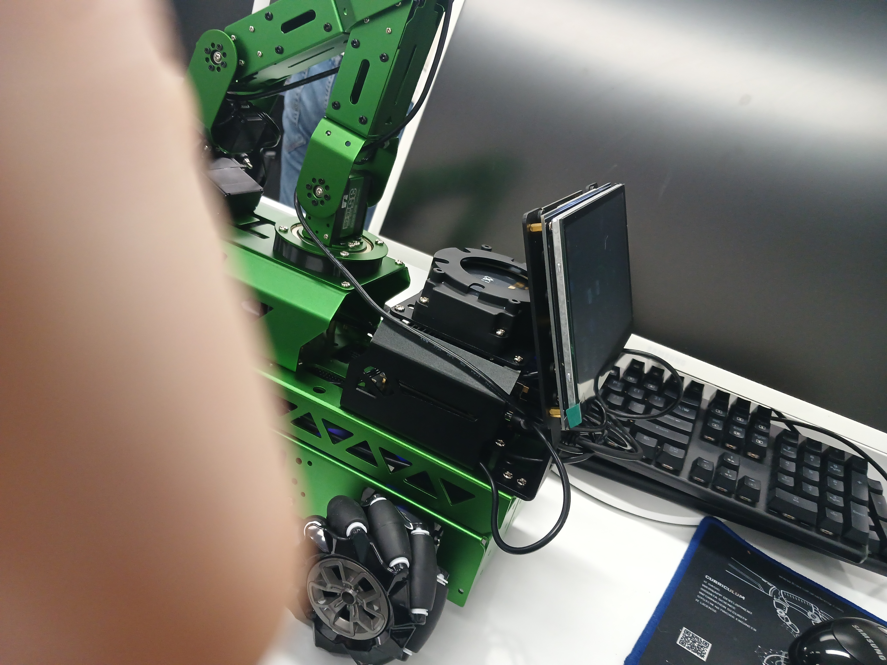
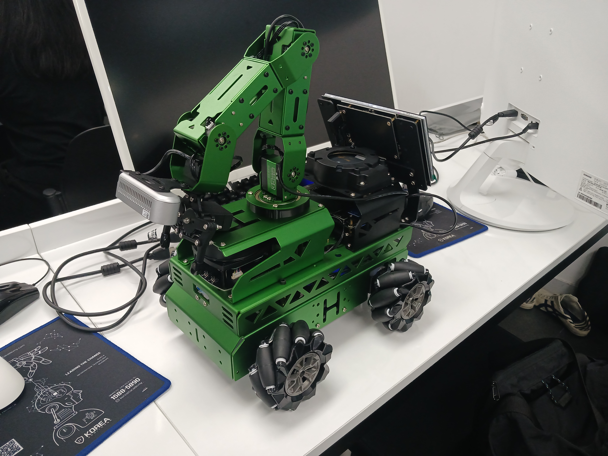

# 로봇 이미지



# 실행 시 나오는 화면
```bash
----------------------------------------------
当前环境是ROS2|The current environment is ROS2
----------------------------------------------
|LIDAR|CAMERA|MIC|ASR|: |A1|Dabai|xf|English|
MACHINE: JetRover_Mecanum
HOST:    /
MASTER:  /
ROS_DOMAIN_ID: 0
VERSION: |V1.1.1|App_ROS2_1.0|2026-01-21|
cat /proc/device-tree/model
> cat /proc/device-tree/model
NVIDIA Jetson Orin Nano Engineering Reference Developer Kit Super%
 ~                                                                                                                    ubuntu@/ | 08:07:56 
> 
```

## lscpu
```bash
> lscpu
Architecture:            aarch64
  CPU op-mode(s):        32-bit, 64-bit
  Byte Order:            Little Endian
CPU(s):                  6
  On-line CPU(s) list:   0-5
Vendor ID:               ARM
  Model name:            Cortex-A78AE
    Model:               1
    Thread(s) per core:  1
    Core(s) per cluster: 3
    Socket(s):           -
    Cluster(s):          2
    Stepping:            r0p1
    CPU max MHz:         1728.0000
    CPU min MHz:         115.2000
    BogoMIPS:            62.50
    Flags:               fp asimd evtstrm aes pmull sha1 sha2 crc32 atomics fphp asimdhp cpuid asimdrdm lrcpc dcpop asimddp uscat ilrcpc fl
                         agm paca pacg
Caches (sum of all):     
  L1d:                   384 KiB (6 instances)
  L1i:                   384 KiB (6 instances)
  L2:                    1.5 MiB (6 instances)
  L3:                    4 MiB (2 instances)
NUMA:                    
  NUMA node(s):          1
  NUMA node0 CPU(s):     0-5
Vulnerabilities:         
  Gather data sampling:  Not affected
  Itlb multihit:         Not affected
  L1tf:                  Not affected
  Mds:                   Not affected
  Meltdown:              Not affected
  Mmio stale data:       Not affected
  Retbleed:              Not affected
  Spec rstack overflow:  Not affected
  Spec store bypass:     Mitigation; Speculative Store Bypass disabled via prctl
  Spectre v1:            Mitigation; __user pointer sanitization
  Spectre v2:            Mitigation; CSV2, but not BHB
  Srbds:                 Not affected
  Tsx async abort:       Not affected
``` 

## jetson_clocks
```bash
> sudo jetson_clocks --show
SOC family:tegra234  Machine:NVIDIA Jetson Orin Nano Engineering Reference Developer Kit Super
Online CPUs: 0-5
cpu0:  Online=1 Governor=schedutil MinFreq=729600 MaxFreq=1728000 CurrentFreq=1420800 IdleStates: WFI=1 c7=1 
cpu1:  Online=1 Governor=schedutil MinFreq=729600 MaxFreq=1728000 CurrentFreq=1728000 IdleStates: WFI=1 c7=1 
cpu2:  Online=1 Governor=schedutil MinFreq=729600 MaxFreq=1728000 CurrentFreq=1420800 IdleStates: WFI=1 c7=1 
cpu3:  Online=1 Governor=schedutil MinFreq=729600 MaxFreq=1728000 CurrentFreq=1497600 IdleStates: WFI=1 c7=1 
cpu4:  Online=1 Governor=schedutil MinFreq=729600 MaxFreq=1728000 CurrentFreq=729600 IdleStates: WFI=1 c7=1 
cpu5:  Online=1 Governor=schedutil MinFreq=729600 MaxFreq=1728000 CurrentFreq=729600 IdleStates: WFI=1 c7=1 
GPU MinFreq=306000000 MaxFreq=1020000000 CurrentFreq=306000000
Active GPU TPCs: 2
EMC MinFreq=204000000 MaxFreq=3199000000 CurrentFreq=2133000000 FreqOverride=0
FAN Dynamic Speed Control=nvfancontrol hwmon0_pwm1=85
NV Power Mode: MAXN_SUPER
```

## tegrastats
```bash
> tegrastats
01-01-1970 08:15:44 RAM 3009/3602MB (lfb 1x4MB) SWAP 1830/9993MB (cached 12MB) CPU [24%@1420,26%@1420,24%@1420,22%@1420,10%@729,12%@729] GR3D_FREQ 0% cpu@53.031C soc2@51.75C soc0@51.968C gpu@52.343C tj@54.75C soc1@54.75C VDD_IN 5152mW/5152mW VDD_CPU_GPU_CV 734mW/734mW VDD_SOC 1513mW/1513mW
01-01-1970 08:15:45 RAM 3008/3602MB (lfb 1x4MB) SWAP 1830/9993MB (cached 12MB) CPU [19%@729,21%@729,21%@729,18%@729,17%@729,18%@729] GR3D_FREQ 0% cpu@52.656C soc2@51.812C soc0@51.937C gpu@52.437C tj@54.968C soc1@54.968C VDD_IN 5112mW/5132mW VDD_CPU_GPU_CV 694mW/714mW VDD_SOC 1513mW/1513mW
01-01-1970 08:15:46 RAM 3008/3602MB (lfb 1x4MB) SWAP 1830/9993MB (cached 12MB) CPU [27%@729,20%@729,20%@729,20%@729,16%@729,15%@729] GR3D_FREQ 0% cpu@52.656C soc2@51.75C soc0@51.968C gpu@52.218C tj@54.937C soc1@54.937C VDD_IN 5112mW/5125mW VDD_CPU_GPU_CV 694mW/707mW VDD_SOC 1513mW/1513mW
01-01-1970 08:15:47 RAM 3009/3602MB (lfb 1x4MB) SWAP 1830/9993MB (cached 12MB) CPU [25%@729,27%@729,21%@729,22%@729,17%@729,16%@729] GR3D_FREQ 0% cpu@52.937C soc2@51.843C soc0@51.937C gpu@52.218C tj@55C soc1@55C VDD_IN 5357mW/5183mW VDD_CPU_GPU_CV 898mW/755mW VDD_SOC 1513mW/1513mW
01-01-1970 08:15:48 RAM 3008/3602MB (lfb 1x4MB) SWAP 1830/9993MB (cached 12MB) CPU [23%@729,18%@729,20%@729,23%@729,19%@729,14%@729] GR3D_FREQ 0% cpu@52.906C soc2@51.812C soc0@51.875C gpu@52.25C tj@54.843C soc1@54.843C VDD_IN 5112mW/5169mW VDD_CPU_GPU_CV 694mW/743mW VDD_SOC 1513mW/1513mW
01-01-1970 08:15:49 RAM 3008/3602MB (lfb 1x4MB) SWAP 1830/9993MB (cached 12MB) CPU [29%@729,21%@729,22%@729,20%@729,18%@729,15%@729] GR3D_FREQ 0% cpu@52.718C soc2@51.812C soc0@51.906C gpu@52.125C tj@54.906C soc1@54.906C VDD_IN 5152mW/5166mW VDD_CPU_GPU_CV 734mW/741mW VDD_SOC 1513mW/1513mW
01-01-1970 08:15:50 RAM 3009/3602MB (lfb 1x4MB) SWAP 1830/9993MB (cached 12MB) CPU [21%@729,18%@729,18%@729,18%@729,18%@729,16%@729] GR3D_FREQ 0% cpu@52.937C soc2@51.812C soc0@52.093C gpu@52.156C tj@54.812C soc1@54.812C VDD_IN 5112mW/5158mW VDD_CPU_GPU_CV 694mW/735mW VDD_SOC 1513mW/1513mW
01-01-1970 08:15:51 RAM 3008/3602MB (lfb 1x4MB) SWAP 1830/9993MB (cached 12MB) CPU [22%@729,20%@729,20%@729,21%@729,20%@729,20%@729] GR3D_FREQ 0% cpu@52.937C soc2@51.781C soc0@51.937C gpu@52.125C tj@54.75C soc1@54.75C VDD_IN 5112mW/5153mW VDD_CPU_GPU_CV 694mW/730mW VDD_SOC 1513mW/1513mW
01-01-1970 08:15:52 RAM 3009/3602MB (lfb 1x4MB) SWAP 1830/9993MB (cached 12MB) CPU [26%@729,20%@729,23%@729,17%@729,17%@729,17%@729] GR3D_FREQ 0% cpu@52.781C soc2@51.906C soc0@52.062C gpu@52.281C tj@54.906C soc1@54.906C VDD_IN 5152mW/5153mW VDD_CPU_GPU_CV 734mW/730mW VDD_SOC 1513mW/1513mW
01-01-1970 08:15:53 RAM 3008/3602MB (lfb 1x4MB) SWAP 1830/9993MB (cached 12MB) CPU [28%@729,16%@729,18%@729,20%@729,16%@729,14%@729] GR3D_FREQ 0% cpu@52.656C soc2@51.843C soc0@52.031C gpu@52.187C tj@54.781C soc1@54.781C VDD_IN 5071mW/5144mW VDD_CPU_GPU_CV 694mW/726mW VDD_SOC 1513mW/1513mW
01-01-1970 08:15:54 RAM 3008/3602MB (lfb 1x4MB) SWAP 1830/9993MB (cached 12MB) CPU [23%@729,19%@729,19%@729,15%@729,18%@729,21%@729] GR3D_FREQ 0% cpu@52.75C soc2@51.843C soc0@52.125C gpu@52.156C tj@54.968C soc1@54.968C VDD_IN 5112mW/5141mW VDD_CPU_GPU_CV 694mW/723mW VDD_SOC 1513mW/1513mW
01-01-1970 08:15:55 RAM 3008/3602MB (lfb 1x4MB) SWAP 1830/9993MB (cached 12MB) CPU [24%@729,18%@729,20%@729,18%@729,13%@729,17%@729] GR3D_FREQ 0% cpu@52.812C soc2@51.843C soc0@51.968C gpu@52.156C tj@54.843C soc1@54.843C VDD_IN 5112mW/5139mW VDD_CPU_GPU_CV 694mW/721mW VDD_SOC 1513mW/1513mW
01-01-1970 08:15:56 RAM 3009/3602MB (lfb 1x4MB) SWAP 1830/9993MB (cached 12MB) CPU [24%@729,21%@729,18%@729,17%@729,16%@729,16%@729] GR3D_FREQ 0% cpu@52.906C soc2@51.906C soc0@52C gpu@52.187C tj@54.812C soc1@54.812C VDD_IN 5071mW/5134mW VDD_CPU_GPU_CV 653mW/716mW VDD_SOC 1513mW/1513mW
01-01-1970 08:15:57 RAM 3008/3602MB (lfb 1x4MB) SWAP 1830/9993MB (cached 12MB) CPU [23%@729,18%@729,21%@729,20%@729,18%@729,15%@729] GR3D_FREQ 0% cpu@52.718C soc2@51.906C soc0@52.031C gpu@52.312C tj@54.906C soc1@54.906C VDD_IN 5112mW/5132mW VDD_CPU_GPU_CV 694mW/714mW VDD_SOC 1513mW/1513mW
01-01-1970 08:15:58 RAM 3006/3602MB (lfb 1x4MB) SWAP 1830/9993MB (cached 12MB) CPU [23%@729,17%@729,20%@729,19%@729,22%@729,20%@729] GR3D_FREQ 0% cpu@52.75C soc2@51.875C soc0@52.156C gpu@52.312C tj@55.031C soc1@55.031C VDD_IN 5112mW/5131mW VDD_CPU_GPU_CV 694mW/713mW VDD_SOC 1513mW/1513mW
01-01-1970 08:15:59 RAM 3006/3602MB (lfb 1x4MB) SWAP 1830/9993MB (cached 12MB) CPU [25%@729,16%@729,17%@729,23%@729,19%@729,16%@729] GR3D_FREQ 0% cpu@52.812C soc2@51.843C soc0@52.093C gpu@52.312C tj@54.875C soc1@54.875C VDD_IN 5112mW/5130mW VDD_CPU_GPU_CV 694mW/712mW VDD_SOC 1513mW/1513mW
01-01-1970 08:16:00 RAM 3004/3602MB (lfb 1x4MB) SWAP 1830/9993MB (cached 12MB) CPU [25%@729,16%@729,23%@729,24%@729,12%@729,17%@729] GR3D_FREQ 0% cpu@52.843C soc2@51.937C soc0@52C gpu@52.187C tj@54.875C soc1@54.875C VDD_IN 5112mW/5129mW VDD_CPU_GPU_CV 694mW/711mW VDD_SOC 1513mW/1513mW
01-01-1970 08:16:01 RAM 3003/3602MB (lfb 1x4MB) SWAP 1830/9993MB (cached 12MB) CPU [20%@729,19%@729,19%@729,15%@729,18%@729,21%@729] GR3D_FREQ 0% cpu@52.812C soc2@51.906C soc0@52.125C gpu@52.187C tj@54.968C soc1@54.968C VDD_IN 5071mW/5125mW VDD_CPU_GPU_CV 694mW/710mW VDD_SOC 1513mW/1513mW
01-01-1970 08:16:02 RAM 3006/3602MB (lfb 1x4MB) SWAP 1830/9993MB (cached 12MB) CPU [23%@729,19%@729,19%@729,16%@729,20%@729,16%@729] GR3D_FREQ 0% cpu@52.875C soc2@51.812C soc0@52.156C gpu@52.343C tj@55.093C soc1@55.093C VDD_IN 5071mW/5123mW VDD_CPU_GPU_CV 694mW/709mW VDD_SOC 1513mW/1513mW
01-01-1970 08:16:03 RAM 3007/3602MB (lfb 1x4MB) SWAP 1830/9993MB (cached 12MB) CPU [23%@729,23%@729,20%@729,25%@729,16%@729,15%@729] GR3D_FREQ 0% cpu@53.093C soc2@51.875C soc0@52.093C gpu@52.343C tj@54.843C soc1@54.843C VDD_IN 5112mW/5122mW VDD_CPU_GPU_CV 694mW/708mW VDD_SOC 1513mW/1513mW
01-01-1970 08:16:04 RAM 3008/3602MB (lfb 1x4MB) SWAP 1830/9993MB (cached 12MB) CPU [23%@729,22%@729,21%@729,19%@729,11%@729,16%@729] GR3D_FREQ 0% cpu@52.781C soc2@51.906C soc0@52.031C gpu@52.437C tj@54.875C soc1@54.875C VDD_IN 5112mW/5122mW VDD_CPU_GPU_CV 694mW/707mW VDD_SOC 1513mW/1513mW
01-01-1970 08:16:05 RAM 3009/3602MB (lfb 1x4MB) SWAP 1830/9993MB (cached 12MB) CPU [23%@729,21%@729,17%@729,18%@729,17%@729,17%@729] GR3D_FREQ 0% cpu@52.906C soc2@51.812C soc0@52.093C gpu@52.343C tj@54.937C soc1@54.937C VDD_IN 5071mW/5119mW VDD_CPU_GPU_CV 694mW/707mW VDD_SOC 1513mW/1513mW
01-01-1970 08:16:06 RAM 3009/3602MB (lfb 1x4MB) SWAP 1830/9993MB (cached 12MB) CPU [25%@729,20%@729,20%@729,22%@729,14%@729,9%@729] GR3D_FREQ 0% cpu@52.812C soc2@51.937C soc0@52.218C gpu@52.25C tj@55.031C soc1@55.031C VDD_IN 5112mW/5119mW VDD_CPU_GPU_CV 694mW/706mW VDD_SOC 1513mW/1513mW
01-01-1970 08:16:07 RAM 3009/3602MB (lfb 1x4MB) SWAP 1830/9993MB (cached 12MB) CPU [23%@729,25%@729,24%@729,22%@729,29%@729,17%@729] GR3D_FREQ 0% cpu@52.875C soc2@51.937C soc0@52.093C gpu@52.218C tj@54.781C soc1@54.968C VDD_IN 5234mW/5124mW VDD_CPU_GPU_CV 816mW/711mW VDD_SOC 1513mW/1513mW
^C
 ~                                                                                                        INT | 25s | ubuntu@/ | 08:16:08 
> 
```

## 이미지 토픽 확인
```bash
> ros2 topic list | grep -Ei 'camera|image|video'
/ar_app/image_result
/depth_cam/color/image_raw/theora
/depth_cam/depth/camera_info
/depth_cam/depth/image_raw
/depth_cam/depth/image_raw/compressed
/depth_cam/depth/image_raw/compressedDepth
/depth_cam/depth/image_raw/theora
/depth_cam/ir/camera_info
/depth_cam/ir/image_raw
/depth_cam/ir/image_raw/compressed
/depth_cam/ir/image_raw/compressedDepth
/depth_cam/ir/image_raw/theora
/depth_cam/rgb/camera_info
/depth_cam/rgb/image_raw
/depth_cam/rgb/image_raw/compressed
/depth_cam/rgb/image_raw/compressedDepth
/hand_trajectory/image_result
/line_following/image_result
/object_tracking/image_result
```

## 촬영 속도
```bash
> ros2 topic hz /depth_cam/rgb/image_raw
average rate: 31.757
        min: 0.005s max: 0.070s std dev: 0.01120s window: 33
average rate: 30.788
        min: 0.005s max: 0.070s std dev: 0.00877s window: 63
average rate: 30.407
        min: 0.005s max: 0.070s std dev: 0.00736s window: 93
average rate: 30.247
        min: 0.005s max: 0.070s std dev: 0.00648s window: 123
average rate: 30.129
        min: 0.005s max: 0.070s std dev: 0.00588s window: 153
average rate: 30.048
        min: 0.005s max: 0.070s std dev: 0.00539s window: 183
average rate: 29.996
        min: 0.005s max: 0.070s std dev: 0.00501s window: 213
average rate: 29.831
        min: 0.005s max: 0.070s std dev: 0.00524s window: 242
average rate: 29.812
        min: 0.005s max: 0.070s std dev: 0.00496s window: 272
average rate: 29.796
        min: 0.005s max: 0.070s std dev: 0.00473s window: 302
average rate: 29.785
        min: 0.005s max: 0.070s std dev: 0.00452s window: 332
average rate: 29.775
        min: 0.005s max: 0.070s std dev: 0.00434s window: 362
average rate: 29.538
        min: 0.005s max: 0.101s std dev: 0.00569s window: 389
average rate: 29.547
        min: 0.005s max: 0.101s std dev: 0.00548s window: 419
average rate: 29.553
        min: 0.005s max: 0.101s std dev: 0.00530s window: 449
average rate: 29.560
        min: 0.005s max: 0.101s std dev: 0.00514s window: 479
average rate: 29.565
        min: 0.005s max: 0.101s std dev: 0.00499s window: 509
average rate: 29.517
        min: 0.005s max: 0.101s std dev: 0.00508s window: 538
average rate: 29.472
        min: 0.005s max: 0.101s std dev: 0.00516s window: 567
average rate: 29.481
        min: 0.005s max: 0.101s std dev: 0.00503s window: 597
average rate: 29.489
        min: 0.005s max: 0.101s std dev: 0.00491s window: 627
average rate: 29.504
        min: 0.005s max: 0.101s std dev: 0.00481s window: 657
average rate: 29.508
        min: 0.005s max: 0.101s std dev: 0.00471s window: 687
average rate: 29.512
        min: 0.005s max: 0.101s std dev: 0.00462s window: 717
average rate: 29.517
        min: 0.005s max: 0.101s std dev: 0.00453s window: 747
average rate: 29.485
        min: 0.005s max: 0.101s std dev: 0.00461s windo
```